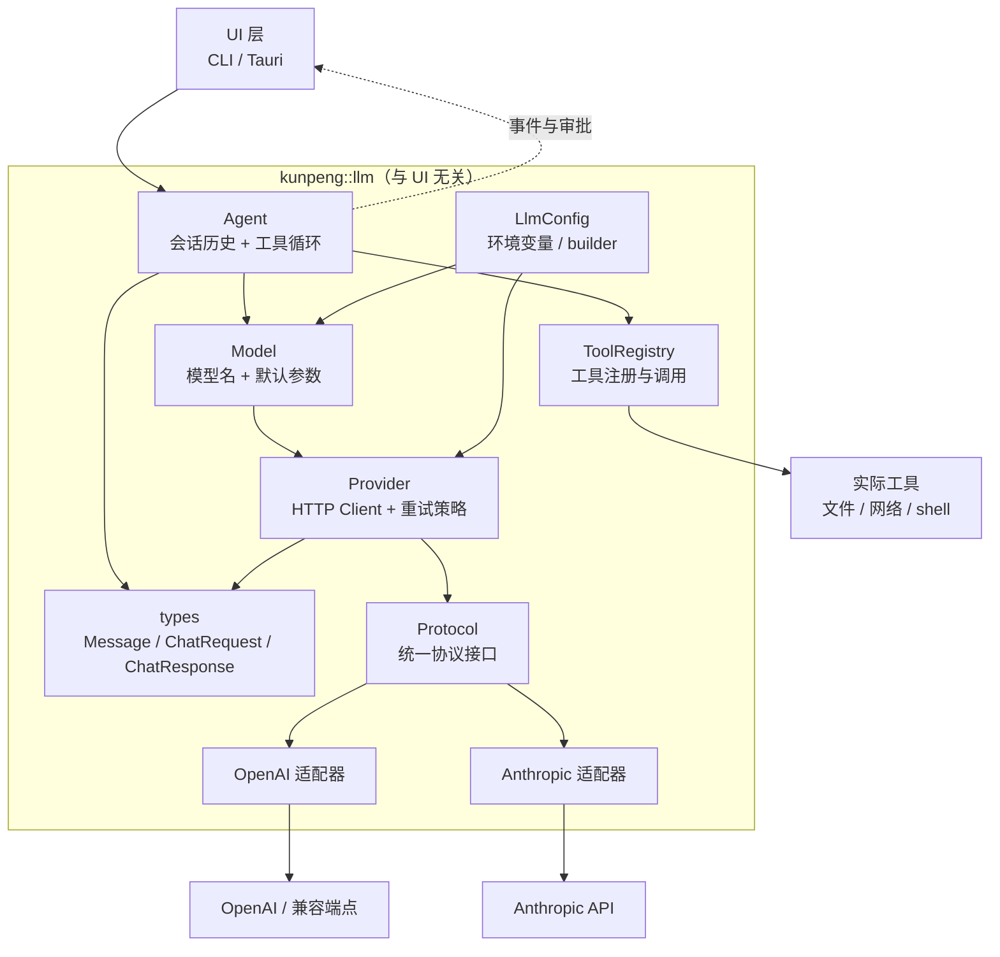
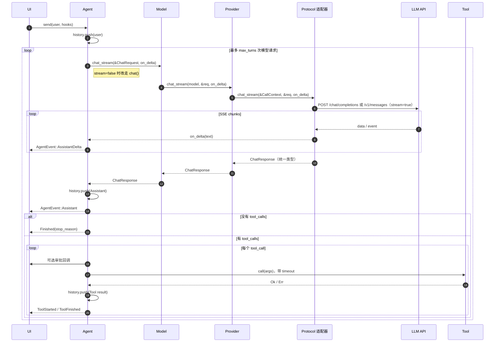

# Kunpeng 整体架构

面向第一次阅读本项目的开发者。目标是用一张分层图、一次完整调用链和几条硬约束，说明“哪个模块负责什么、为什么这样拆”。

---

## 一句话理解

这是一个**分层 + 适配器**结构：

> `Agent` 负责“怎么对话、怎么调工具”，`Model/Provider` 负责“怎么发请求”，`OpenAI/Anthropic 适配器` 负责“把统一消息翻译成各家协议”，UI 只负责“显示事件、决定是否允许工具执行”。

核心代码在 `kunpeng::llm` library 中，`src/main.rs` 只是一个交互式 CLI 消费示例。Tauri 或其他 UI 可以替换 `main.rs`，复用同一套内核。

---

## 分层结构



依赖方向是单向的：

```text
UI → Agent → Model → Provider → Protocol → 具体适配器
        ↘ ToolRegistry → Tool
```

上层不知道下层的实现细节，下层也不反向依赖 UI。

---

## 各层职责

| 层 | 代码位置 | 负责什么 | 不负责什么 |
|---|---|---|---|
| UI | `src/main.rs`、未来的 Tauri | 读取输入、渲染事件、审批工具 | 不拼 HTTP、不处理 provider 差异 |
| 编排 | `src/llm/agent.rs` | 维护历史、循环请求模型、执行工具、发事件、取消 | 不关心 JSON 字段名 |
| 模型绑定 | `src/llm/model.rs` | 绑定模型名、补默认 temperature/max_tokens | 不持有会话历史 |
| 连接 | `src/llm/provider/mod.rs` | 创建 HTTP Client、校验 URL、重试 | 不解析具体协议 |
| 协议接口 | `src/llm/provider/protocol.rs` | 定义 `Protocol`、共享重试/截断工具 | 不知道业务 |
| 协议适配 | `src/llm/provider/openai.rs`、`anthropic.rs` | 统一消息 ↔ 各家 JSON | 不管理工具循环 |
| 语义类型 | `src/llm/types.rs` | `Message`、`ChatRequest`、`ChatResponse`、`ToolCall` | 不依赖网络和 UI |
| 工具 | `src/llm/tool.rs` | 工具定义、注册、查找、调用 | 不管审批和超时 |
| 配置 | `src/llm/config.rs` | 环境变量、默认值、构建 Model | 不发起请求 |
| 错误 | `src/llm/error.rs` | 区分配置/网络/API/工具/取消错误 | 不负责展示 |

### 文件地图

```text
src/
├── lib.rs                    公开 library，只导出 llm 模块
├── main.rs                   交互式 CLI：输入循环 → Agent → 事件打印
└── llm/
    ├── mod.rs                分层说明与公开 re-export
    ├── types.rs              协议无关的消息/请求/响应/工具调用类型
    ├── error.rs              统一错误类型
    ├── config.rs             LlmConfig：env 与 builder，构建 Model
    ├── model.rs              Model：Provider + 模型名 + 默认参数
    ├── tool.rs               Tool trait 与 ToolRegistry
    ├── agent.rs              Agent：历史、循环、事件、审批、取消、超时
    └── provider/
        ├── mod.rs            Provider：HTTP Client、base_url、API key、重试
        ├── protocol.rs       Protocol trait、SSE 解码、重试/解析/截断
        ├── openai.rs         OpenAI Chat Completions 适配器
        └── anthropic.rs      Anthropic Messages API 适配器
```

---

## 一次工具调用的完整流程



核心循环只有一句话：

> **请求模型 → 如果模型要工具就执行工具 → 把结果追加到历史 → 再请求模型**，直到模型不再要工具或达到 `max_turns`。

---

## 核心数据类型

| 类型 | 含义 | 为什么需要 |
|---|---|---|
| `Message` | 一条会话消息：system/user/assistant/tool | 协议无关的会话单位 |
| `ChatRequest` | 一次模型请求 | 借用历史切片，避免每轮复制整段会话 |
| `ChatResponse` | 一次模型回复 | 统一 content、tool_calls、usage、finish_reason |
| `ToolDefinition` | 工具 schema | 发给模型声明可用工具 |
| `ToolCall` | 模型发起的一次工具调用 | 带 id，工具结果需要按 id 回传 |
| `AgentEvent` | 过程中的事件 | UI 渲染进度、工具状态、错误 |
| `StopReason` | 整个循环为什么停止 | 区分正常完成、超长、达到轮数、取消 |
| `FinishReason` | 单次模型响应为什么结束 | 统一 OpenAI/Anthropic 的不同字符串 |
| `Error` | 分类错误 | 配置、HTTP、API、解析、工具、取消分别处理 |

`Message` 用 enum 而不是 `role: String + content: String`，因为 assistant 至少有三种状态：纯文本、纯工具调用、文本 + 工具调用；tool 结果还必须绑定 `tool_call_id`。非法组合在编译期就不存在。

---

## 关键设计决策

### 1. 语义层和协议层分开

`Agent` 只认识 `Message`，不认识 OpenAI 的 `role/content/tool_calls`，也不认识 Anthropic 的 content block 数组。

新增 provider 时不需要改 Agent，只需要：

1. 实现 `Protocol`；
2. 写 `Message` ↔ 该协议的转换；
3. 在 `protocol_by_name` 和 `config` 里加别名/默认值；
4. 加 mock 或本地 fake server 测试。

这是适配器模式：**内核说通用语言，适配器负责翻译**。

### 2. Agent 是有状态的

历史放在 `Agent` 里，而不是每次调用都让 UI 传入：

- 网络失败后，历史还在，可以直接 `resume()`；
- 达到 `MaxTurns` 后可以继续；
- UI 可以随时 `history()` 读取并持久化；
- 事件回调能在正确的时间点拿到一致的状态。

关键约束：

> assistant 消息里的每个 `tool_call` 都必须在历史里有对应的 `tool_result`。

否则下一次请求会被 OpenAI/Anthropic 判为非法。取消时 Agent 会给未执行的调用补错误结果，就是为了守住这条约束。

### 3. 请求借用历史，而不是复制

`ChatRequest<'a>` 里是 `&[Message]`、`&[ToolDefinition]`。

如果每轮按值传历史，一段 n 条消息的会话会复制 O(n²) 次。借用后：

- 请求期间历史只读；
- 请求返回后再 `push` assistant 消息；
- 请求块结束，借用释放。

### 4. 工具是唯一的副作用边界

Agent 本身不读文件、不跑命令。所有副作用都在 `Tool` 实现里。

工具执行前有审批钩子：

```text
Allow → 执行
Deny(reason) → 不执行，写入 is_error 的 tool_result
```

工具错误不会中断整轮对话，而是作为工具结果回传给模型，让模型有机会换方案。只有模型请求失败、配置错误和取消会直接返回 `Err`。

### 5. 重试放在共享协议层

`send_with_retry` 对 408/429/5xx 做指数退避，并优先使用 `Retry-After`。

放在 `protocol.rs` 而不是两个适配器里，避免 OpenAI 和 Anthropic 各写一套。注意它是**按单次尝试**计算 timeout 的，总耗时可能约为 `timeout × (重试次数 + 1)`。

### 6. 工具顺序固定

`ToolRegistry` 用 `BTreeMap`，不是 `HashMap`。

工具定义会进入 prompt，顺序随机会导致：

- OpenAI/Anthropic 的前缀缓存命中率下降；
- 快照测试不稳定；
- 同一个工具集在不同进程里 prompt 不一致。

### 7. UI 通过事件观察，不直接介入循环

`AgentEvent` 是普通可序列化数据：

```text
AssistantDelta* → Assistant → (ToolStarted → ToolFinished)* → Finished
```

`AssistantDelta` 只是展示用的临时文本；最终内容以 `Assistant` 为准。失败或取消时，UI 应丢弃增量缓冲。失败时由 `Error` 事件替代 `Finished`。

Tauri 可以直接把事件 `emit` 给前端；CLI 直接打印；测试收集到 `Vec` 里断言。内核不依赖任何 UI 类型。

### 8. 取消和超时分开处理

- 取消令牌只在模型请求上 `select!`，可以立即 drop HTTP 请求；
- 工具执行期间不中途取消，只在工具之间检查，避免留下子进程；
- 单个工具的硬上限由 `AgentConfig::tool_timeout` 控制。

### 9. 流式在协议层收敛，Agent 只消费文本增量

`Protocol::chat_stream` 的默认实现退回 `chat`，把完整文本作为单个增量发出。新增 provider 可以先只实现非流式，Agent 不需要判断对方是否支持 SSE。

两个适配器各自处理 SSE：

- 共用 `SseDecoder`：跨 chunk 缓冲、按行解析、处理 CRLF/多行 `data:`；
- OpenAI：按 `tool_calls[].index` 累积 id/name/arguments 分片，`[DONE]` 结束；
- Anthropic：文本走 `text_delta`，工具参数走 `input_json_delta`，按 content block index 累积；
- 最终都组装成同一个 `ChatResponse`，Agent 的工具循环与非流式完全一致。

`AgentConfig::stream` 默认开启。不支持 SSE 的兼容端点设为 `false`；流式请求的 usage 取决于服务端是否主动发送。

---

## 失败与退出路径

| 场景 | 结果 | 历史状态 |
|---|---|---|
| 模型正常回复，不需要工具 | `StopReason::Completed` | 末尾是 assistant |
| 模型调用工具 | 执行后进入下一轮模型请求 | 末尾是 tool_result |
| 达到 `max_turns` | `StopReason::MaxTurns` | 末尾可能是 tool_result，可 `resume()` |
| 模型因 token 上限停止 | `StopReason::Length` | 末尾是 assistant，正文可能被截断 |
| 内容被安全策略过滤 | `StopReason::ContentFilter` | 末尾是 assistant |
| 模型请求失败 | 返回 `Err`，发 `Error` 事件 | 不追加消息，可 `resume()` |
| 流式中途失败/取消 | 返回 `Err` / `StopReason::Cancelled` | 不追加 assistant；UI 丢弃增量缓冲 |
| 工具失败/超时/被拒绝 | 循环继续 | 写入 `is_error=true` 的 tool_result |
| 用户取消 | `StopReason::Cancelled` | 给未完成调用补取消结果，可继续 |

---

## 修改指南

### 加一个工具

1. 实现 `Tool`；
2. 在 `ToolRegistry` 里 `register`；
3. `definition` 里的 `input_schema` 写清楚参数；
4. `call` 里自己校验参数，返回 `Result<String>`。

不要在工具里做审批；审批在 `AgentHooks::approve`。

### 加一个 provider

1. 在 `src/llm/provider/` 新建适配器，实现 `Protocol`；
2. 把 `types::Message` 转成对方请求 JSON；
3. 把对方响应转成 `ChatResponse`；
4. 在 `protocol_by_name` 加别名；
5. 在 `config.rs` 加默认 base URL/model（如果适用）；
6. 用本地 fake HTTP 服务写 smoke test。

### 接一个新 UI

1. 用 `LlmConfig` 或它的 builder 创建 `Model`；
2. 注册工具；
3. 创建 `Agent`；
4. 调 `send`，在 `AgentHooks` 里把事件转发给 UI；
5. 需要“允许执行工具吗”时实现 `approve`；
6. 退出/切会话时保存 `agent.history()`。

---

## 推荐阅读顺序

1. `src/llm/types.rs`：先看数据长什么样。
2. `src/llm/error.rs`：看错误如何分类。
3. `src/llm/tool.rs`：工具接口和注册表。
4. `src/llm/model.rs`：一次模型调用的入口。
5. `src/llm/provider/protocol.rs` + 两个适配器：看协议如何翻译。
6. `src/llm/agent.rs`：最后看循环、事件、取消和审批。
7. `src/llm/config.rs` 和 `src/main.rs`：看如何组装和消费。

---

## 当前边界

这些是已知的、有意保留的后续项：

- Anthropic 的 `thinking`、服务端工具等未知 block 会被忽略，启用 extended thinking 前需要保存原始 block；
- 没有上下文窗口裁剪，长会话仍可能超过模型上限；
- 工具审批是同步回调，Tauri 若需要真正异步等待用户确认，需要扩展成 async approver。
