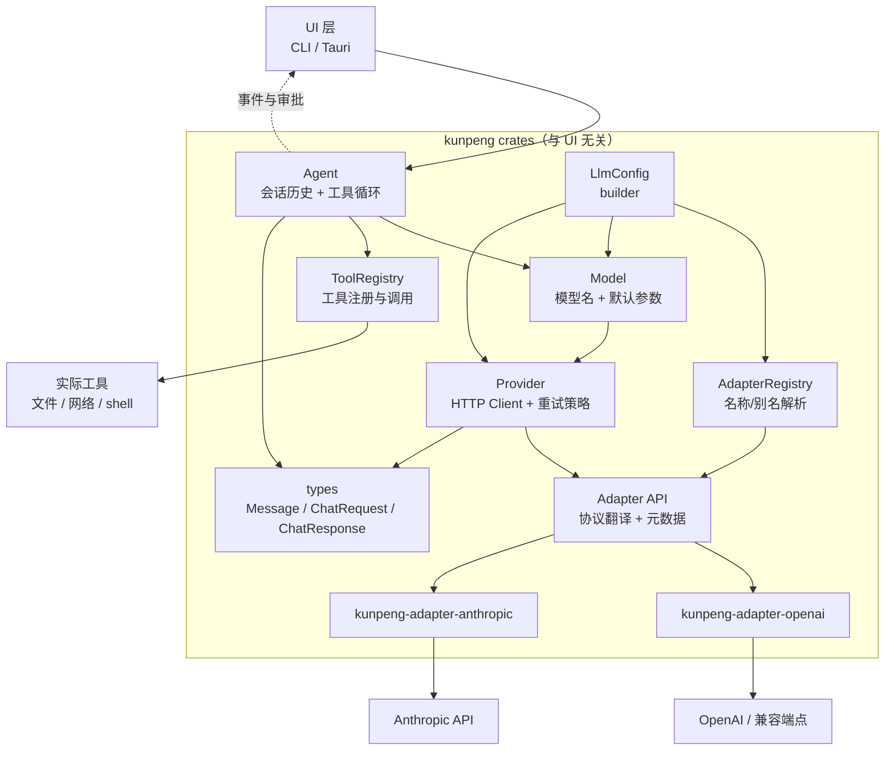
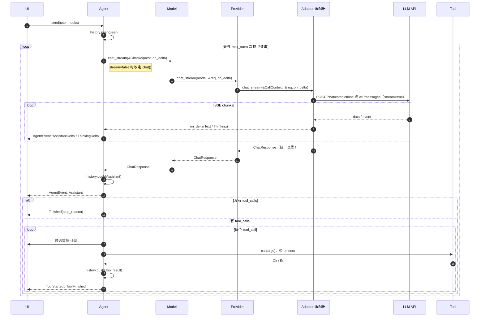

# Kunpeng 整体架构

面向第一次阅读本项目的开发者。目标是用一张分层图、一次完整调用链和几条硬约束，说明“哪个模块负责什么、为什么这样拆”。

---

## 一句话理解

这是一个**分层 + 适配器**结构：

> `Agent` 负责“怎么对话、怎么调工具”，`Model/Provider` 负责“怎么发请求”，`OpenAI/Anthropic 适配器` 负责“把统一消息翻译成各家协议”，UI 只负责“显示事件、决定是否允许工具执行”。

核心代码在 `kunpeng::core` / `kunpeng::provider` / `kunpeng::runtime` / `kunpeng::agents` 中，`crates/kunpeng-cli/src/main.rs` 只是一个交互式 CLI 消费示例。Tauri 或其他 UI 可以替换 `main.rs`，复用同一套内核。

---

## 分层结构



依赖方向是单向的：

```text
UI → Agent → Model → Provider → Adapter → 具体适配器 crate
        ↘ ToolRegistry → Tool
AdapterRegistry 按名称/别名选择 Adapter；core 不认识厂商。
```

上层不知道下层的实现细节，下层也不反向依赖 UI。

---

## 各层职责

| 层 | 代码位置 | 负责什么 | 不负责什么 |
|---|---|---|---|
| UI | `crates/kunpeng-cli/src/main.rs`、未来的 Tauri | 读取输入、渲染事件、审批工具 | 不拼 HTTP、不处理 provider 差异 |
| Agent 实现 | `crates/kunpeng-agents/src/` | ReAct 等策略；`Agent` 门面 | 不维护 provider 协议 |
| Runtime | `crates/kunpeng-runtime/src/lib.rs` | `RunConfig`、事件、审批、取消 | 不引用模型/工具/上下文实现 |
| Context | `crates/kunpeng-context/src/` | token 预算、滑动窗口裁剪 | 不调用模型，不依赖 memory |
| RAG | `crates/kunpeng-rag/src/` | 记忆召回注入上下文 | 不修改 Agent 循环 |
| Memory | `crates/kunpeng-memory/src/` | Memory / SessionStore 契约与内存实现 | 不修改 Agent 循环 |
| Multi | `crates/kunpeng-multi/src/` | AgentBus、Envelope、AgentProtocol、Worker、Supervisor | 不执行具体 LLM 调用 |
| MCP | `crates/kunpeng-mcp/src/` | MCP stdio、tools/resources/prompts/sampling、ToolProvider | 不依赖 Agent/runtime |
| A2A | `crates/kunpeng-a2a/src/` | Agent Card、message/send、message/stream、tasks/*、push 配置 | 不实现本地 mailbox/webhook server |
| ANP | `crates/kunpeng-anp/src/` | JSON-LD 信封映射、HTTP 传输、`did:web` 发现 | 不硬编码其他 DID method/厂商 profile |
| Android | `crates/kunpeng-android/src/` | 诊断领域类型、能力接缝（日志/解析/代码/设备）、Android 工具与 Agent 组装 | 不依赖 provider/UI；adb 与符号索引实现后续按 trait 接入 |
| 模型抽象 | `crates/kunpeng-core/src/chat_model.rs` | `ChatModel` trait | 不包含 HTTP/厂商协议 |
| 模型绑定 | `crates/kunpeng-provider/src/model.rs` | `Model`、模型名、默认参数 | 不持有会话历史 |
| 连接 | `crates/kunpeng-provider/src/provider.rs` | HTTP Client、URL 校验、重试 | 不解析具体协议 |
| 适配器 API | `crates/kunpeng-provider/src/adapter.rs` | `Adapter`、重试/截断/响应解析 | 不知道业务 |
| 通用 HTTP | `crates/kunpeng-http/src/lib.rs` | reqwest 错误映射、SSE 解码、限时 body 读取 | 不认识 provider、Agent 或协议 |
| 适配器注册 | `crates/kunpeng-provider/src/registry.rs` | 名称/别名 -> Adapter | 不绑定厂商 |
| 协议适配 | `crates/kunpeng-adapter-openai/`、`kunpeng-adapter-anthropic/` | 统一消息 ↔ 各家 JSON | 不管理工具循环 |
| 语义类型 | `crates/kunpeng-core/src/types.rs` | `Message`、`ChatRequest`、`ChatResponse`、`ToolCall` | 不依赖网络和 UI |
| 工具 | `crates/kunpeng-tools/src/` | 工具定义、注册、策略、内置工具 | 不管审批和超时 |
| 配置 | `crates/kunpeng-provider/src/config.rs` | `LlmConfig`、注册表解析、构建 Model | 不读取 env、不知道厂商 |
| 宿主配置 | `crates/kunpeng-cli/src/config.rs` | 环境变量读取、trim、类型转换 | 不包含协议默认值 |
| 错误 | `crates/kunpeng-core/src/error.rs` | 区分网络/API/工具/取消错误 | 不负责展示 |

### 文件地图

```text
Cargo.toml                       workspace 根
crates/
├── kunpeng/                     umbrella：core / runtime / agents / ...
├── kunpeng-core/
│   ├── src/types.rs             协议无关的消息/请求/响应/多模态类型
│   ├── src/error.rs             统一错误类型
│   └── src/chat_model.rs        ChatModel trait
├── kunpeng-provider/
│   ├── src/adapter.rs           Adapter API、重试/解析/截断（re-export kunpeng-http）
│   ├── src/registry.rs          AdapterRegistry
│   ├── src/provider.rs          Provider：HTTP Client、base_url、API key、重试
│   ├── src/model.rs             Model：模型名 + 默认参数
│   └── src/config.rs            LlmConfig + 适配器解析
├── kunpeng-http/
│   └── src/lib.rs               http_error、SseDecoder/consume_sse、read_body
├── kunpeng-adapter-openai/
│   └── src/lib.rs               OpenAI Chat Completions Adapter
├── kunpeng-adapter-anthropic/
│   └── src/lib.rs               Anthropic Messages Adapter
├── kunpeng-runtime/
│   └── src/lib.rs               RunConfig、事件、审批、取消
├── kunpeng-agents/
│   ├── src/lib.rs               AgentStrategy trait + RunContext
│   ├── src/react.rs             Agent 门面 + ReActAgent
│   └── src/tests.rs             Agent 循环测试
├── kunpeng-tools/
│   ├── src/lib.rs               工具系统入口、ToolProvider
│   ├── src/registry.rs          Tool trait 与 ToolRegistry
│   ├── src/policy.rs            ToolPolicy（超时/输出截断）
│   └── src/builtin/             time / fs_read / http_fetch
├── kunpeng-context/
│   ├── src/lib.rs               上下文工程入口
│   ├── src/token.rs             TokenCounter
│   └── src/builder.rs           SlidingWindowContext
├── kunpeng-memory/
│   ├── src/lib.rs               Memory / MemoryItem / SessionStore
│   └── src/in_memory.rs         InMemoryMemory / InMemorySessionStore
├── kunpeng-rag/
│   └── src/lib.rs               RagContextBuilder
├── kunpeng-multi/
│   ├── src/lib.rs               AgentId / AgentEnvelope / AgentPayload / AgentProtocol
│   ├── src/bus.rs               AgentBus / LocalBus
│   └── src/supervisor.rs        Worker / AgentWorker / Supervisor
├── kunpeng-mcp/
│   └── src/lib.rs               MCP stdio 客户端、ToolProvider
├── kunpeng-a2a/
│   └── src/lib.rs               A2A Agent Card / message/send / tasks/get
├── kunpeng-anp/
│   └── src/lib.rs               ANP JSON-LD HTTP 传输
├── kunpeng-android/
│   ├── src/lib.rs               Android 诊断领域层入口
│   ├── src/types.rs             崩溃报告 / 堆栈帧 / 日志行与会话元数据 / 代码命中 / 设备信息
│   ├── src/capability/          LogSessionStore / LogProvider / LogParser / CodeIndex / DeviceConnector
│   ├── src/analysis/            确定性分析：stats / grep / templates / catalog / events / boot / cross / diff / perf
│   ├── src/builtin/             离线默认实现（内存会话、静态日志、文件代码索引、Java/ANR 解析器）
│   ├── src/tools/               log_*（open/sessions/stats/grep/read/cluster）、android_*（crashes/log_parse/code/device）
│   ├── src/env.rs               AndroidEnv：能力装配 + 工具注册表
│   └── src/agent.rs             AndroidProfile 预设 + build_agent
└── kunpeng-cli/
    ├── src/lib.rs               CLI 宿主库入口
    ├── src/config.rs            环境变量 -> LlmConfig
    ├── src/main.rs              交互式 CLI
    └── examples/basic_agent.rs  最小示例
```

---

## 一次工具调用的完整流程



核心循环只有一句话：

> **请求模型 → 如果模型要工具就执行工具 → 把结果追加到历史 → 再请求模型**，直到模型不再要工具或达到 `max_turns`。

---

## 核心数据类型

| 类型 | 含义 | 为什么需要 |
|---|---|---|
| `Message` | 一条会话消息：system/user/assistant/tool | 协议无关的会话单位 |
| `Content` / `ContentPart` | 用户消息内容 | 纯文本或多模态 parts |
| `ToolChoice` | 工具选择策略 | 映射 OpenAI/Anthropic 的不同结构 |
| `ProviderOptions` | provider 专属参数 | 透传 seed/top_k 等扩展字段 |
| `ChatRequest` | 一次模型请求 | 借用历史切片，避免每轮复制整段会话 |
| `ChatResponse` | 一次模型回复 | 统一 content、tool_calls、usage、finish_reason |
| `ToolDefinition` | 工具 schema | 发给模型声明可用工具 |
| `ToolCall` | 模型发起的一次工具调用 | 带 id，工具结果需要按 id 回传 |
| `ThinkingConfig` | 扩展思考预算 | Anthropic `budget_tokens` |
| `ProviderData` | provider 原始 block | thinking/signature 和未知 block 原样回放 |
| `ServerToolUse` | 服务端工具只读投影 | 展示 `server_tool_use`，不参与本地执行 |
| `StreamDelta<'a>` | 流式增量 | 借用正文/思考字符串，避免回调层 clone |
| `StreamControl` | 流式控制 | 消费方可以停止继续读取网络流 |
| `AgentEvent` | 过程中的事件 | UI 渲染进度、工具状态、错误 |
| `StopReason` | 整个循环为什么停止 | 区分正常完成、超长、达到轮数、取消 |
| `FinishReason` | 单次模型响应为什么结束 | 统一 OpenAI/Anthropic 的不同字符串 |
| `Error` | 分类错误 | HTTP 分类/source、Api/RateLimited、Json/ParseResponse、工具、取消分别处理 |

`Message` 用 enum 而不是 `role: String + content: String`，因为 assistant 至少有三种状态：纯文本、纯工具调用、文本 + 工具调用；tool 结果还必须绑定 `tool_call_id`。非法组合在编译期就不存在。

---

## 关键设计决策

### 1. 语义层和协议层分开

`Agent` 只认识 `Message`，不认识 OpenAI 的 `role/content/tool_calls`，也不认识 Anthropic 的 content block 数组。

新增 provider 时不需要改 Agent，只需要：

1. 新建独立 crate，依赖 `kunpeng-provider`；
2. 实现 `Adapter`，声明名称/别名/默认地址/默认模型；
3. 写 `Message` ↔ 该协议的转换；
4. 在宿主注册表注册该 Adapter，或直接加入 `default_adapter_registry`；
5. 加 mock 或本地 fake server 测试。

这是适配器模式：**内核说通用语言，适配器负责翻译**。厂商 wire struct 留在各 adapter crate 内部，标记为 Adapter Internal，不从 crate 导出；稳定边界只有 `Adapter` trait 和 core 语义类型。

### 2. Agent 是有状态的

历史放在 `Agent` 里，而不是每次调用都让 UI 传入：

- 网络失败后，历史还在，可以直接 `resume()`；
- 达到 `MaxTurns` 后可以继续；
- UI 可以随时 `history()` 读取并持久化；
- 事件回调能在正确的时间点拿到一致的状态。

关键约束：

> assistant 消息里的每个 `tool_call` 都必须在历史里有对应的 `tool_result`。

否则下一次请求会被 OpenAI/Anthropic 判为非法。取消时 Agent 会给未执行的调用补错误结果，就是为了守住这条约束。

### 3. 请求借用历史，而不是复制

`ChatRequest<'a>` 里是 `&[Message]`、`&[ToolDefinition]`。

如果每轮按值传历史，一段 n 条消息的会话会复制 O(n²) 次。借用后：

- 请求期间历史只读；
- 请求返回后再 `push` assistant 消息；
- 请求块结束，借用释放。

### 4. 工具是唯一的副作用边界

Agent 本身不读文件、不跑命令。所有副作用都在 `Tool` 实现里。

工具执行前有审批钩子：

```text
Allow → 执行
Deny(reason) → 不执行，写入 is_error 的 tool_result
```

审批实现为 async `ToolApprover`，UI 可以发 IPC 请求后 await 用户的决定；Agent 同时监听取消令牌和 `approval_timeout`。超时按拒绝处理。

工具错误不会中断整轮对话，而是作为工具结果回传给模型，让模型有机会换方案。只有模型请求失败、配置错误和取消会直接返回 `Err`。

### 5. 重试放在共享协议层

`send_with_retry` 对 408/429/5xx 做指数退避，并优先使用 `Retry-After`。

放在 `provider/src/adapter.rs` 而不是两个适配器里，避免 OpenAI 和 Anthropic 各写一套。超时按**阶段**而不是整次请求施加：`send_with_retry` 限制单次尝试到响应头为止，非流式 body 读取由 `read_body` 限时，流式由 `consume_sse` 的空闲超时兜底——一次长流式生成可以合法超过任何总上限，只有某一阶段停滞才应中断。最坏总耗时约为 `timeout × (重试次数 + 1)`。

### 6. 工具顺序固定

`ToolRegistry` 用 `BTreeMap`，不是 `HashMap`。

工具定义会进入 prompt，顺序随机会导致：

- OpenAI/Anthropic 的前缀缓存命中率下降；
- 快照测试不稳定；
- 同一个工具集在不同进程里 prompt 不一致。

### 7. UI 通过事件观察，不直接介入循环

`AgentEvent` 是普通可序列化数据：

```text
AssistantDelta* / ThinkingDelta* → Assistant → (ToolStarted → ToolFinished)* → Finished
```

`AssistantDelta`/`ThinkingDelta` 只是展示用的临时内容；最终内容以 `Assistant` 为准。失败或取消时，UI 应丢弃增量缓冲。失败时由 `Error` 事件替代 `Finished`。

Tauri 可以直接把事件 `emit` 给前端；CLI 直接打印；测试收集到 `Vec` 里断言。内核不依赖任何 UI 类型。

### 8. 取消和超时分开处理

- 取消令牌在模型请求、工具审批等待上 `select!`，可以立即返回 Cancelled；
- 工具执行期间不中途取消，只在工具之间检查，避免留下子进程；
- 单个工具的硬上限由 `RunConfig::tool_timeout` 控制；
- 审批等待上限由 `RunConfig::approval_timeout` 控制，超时转为拒绝。

### 9. 流式在协议层收敛，Agent 只消费增量事件

`Adapter::chat_stream` 的默认实现退回 `chat`，先发 thinking、再发 text，避免 UI 把推理内容排在正文之后。回调接收借用的 `StreamDelta<'_>`，默认回退不会为了发事件 clone 完整回复；消费方返回 `StreamControl::Stop` 后适配器停止读取并返回 `Error::Cancelled`。新增 provider 可以先只实现非流式，Agent 不需要判断对方是否支持 SSE。

两个适配器各自处理 SSE：

- 共用 `kunpeng-http` 的 `SseDecoder`：跨 chunk 缓冲、按行解析、处理 CRLF/多行 `data:`，相邻 chunk 之间的空闲等待有上限；
- OpenAI：按 `tool_calls[].index` 累积 id/name/arguments 分片，`[DONE]` 结束；
- Anthropic：文本走 `text_delta`，思考走 `thinking_delta`/`signature_delta`，工具参数走 `input_json_delta`，按 content block index 累积；
- 最终都组装成同一个 `ChatResponse`，Agent 的工具循环与非流式完全一致。

`RunConfig::stream` 默认开启。不支持 SSE 的兼容端点设为 `false`；流式请求的 usage 取决于服务端是否主动发送。

### 10. Thinking 和未知 block 用原始 JSON 回放

Anthropic 的 thinking block 带 `signature`，下一轮必须原样带回；`redacted_thinking`、`server_tool_use`、`web_search_tool_result` 等 block 也有同样的结构要求。语义层不可能为每种 block 建类型，所以：

- `ChatResponse.provider_data` / `Message::Assistant.provider_data` 保存完整 content 数组；
- 下一轮 `to_anthropic_messages` 发现 provider 是 Anthropic 时，直接使用原始数组，不按 text/tool_calls 重建；
- `thinking` 字段只保存拼接后的可读文本，供 UI 展示；
- 流式路径把 `thinking_delta` 累积成文本、`signature_delta` 追加到签名，未知 block 保留 start JSON，`input_json_delta` 合并进 `input`。

这样 block 顺序、签名和未知字段都不会丢。代价是 `provider_data` 不能手改；它属于 provider 的不透明数据。

### 11. 服务端工具走独立通道，citations 只做投影

服务端工具由 Anthropic 执行，客户端不能把它当成本地 `ToolCall`：

- `RunConfig.server_tools` 保存服务端工具定义，Anthropic 适配器把本地函数工具和服务端工具合并进 `tools` 数组；
- `server_tool_use` 不进入 `tool_calls`，只投影到 `ChatResponse.server_tool_uses` / `AgentEvent::Assistant.server_tool_uses`；
- `server_tool_use` / `*_tool_result` 仍在 `provider_data` 中，下一轮原样回放；
- `pause_turn` 映射为 `FinishReason::Pause`，Agent 不追加用户消息，直接进入下一轮；
- citations 结构差异大，先以原始 JSON 放进 `ChatResponse.citations` / `Message::Assistant.citations`；
- 流式 `citations_delta` 累积到 text block，最终同时写入语义字段和原始 block。

不要把服务端工具注册进 `ToolRegistry`，也不要让它走本地审批/超时逻辑。

### 12. 工具审批是异步 trait

审批不能是同步闭包：Tauri 需要把请求发给前端，再等待 IPC 回调。`ToolApprover` 用 `async_trait` 返回 future，Agent 在审批点上 await，同时用 `select!` 监听取消令牌。

推荐 UI 实现：

- 生成 `oneshot::Sender`，按 `call.id` 存在 map 里；
- 通过事件系统把 `ToolCall` 发给前端；
- 前端确认后调用 command，取出 sender 并发送 `ToolDecision`；
- `approval_timeout` 到期按 `Deny` 处理，避免 UI 未响应时永久挂起；
- 取消时 Agent 直接返回 `Cancelled`，并补齐当前及剩余工具结果。

### 13. 多模态和扩展参数

多模态不直接暴露 provider JSON，而是先建语义层：

- `Content::Text` 保持字符串，避免普通消息多包一层数组；
- `ContentPart::Text/Image` 结构化映射；
- `ContentPart::Other { provider, data }` 透传 PDF、音频等尚未类型化的 block；
- 跨 provider 的 `Other` 会返回配置错误，防止把 Anthropic block 发给 OpenAI。

请求扩展：

- `ToolChoice` 统一 `Auto/None/Required/Tool`，由适配器翻译；
- `stop_sequences` 映射 OpenAI `stop` / Anthropic `stop_sequences`；
- `ProviderOptions` 按 provider 合并原始字段，作为 `seed`、`response_format`、`top_k` 等参数的逃生口；
- core 字段（`model`、`messages`、`tools`、`stream`）不应通过 `ProviderOptions` 覆盖。

### 14. 上下文工程独立于 Agent 策略

`ContextBuilder` 只回答一个问题：这次请求应该发送哪些历史。

- `TokenBudget` 是可选配置，默认不裁剪；
- `ApproxTokenCounter` 先做保守估算，后续可替换精确 tokenizer；
- `SlidingWindowContext` 按 User 轮次整轮裁剪，避免拆散 tool_calls/tool_result；
- system 和最新一轮始终保留；
- `kunpeng-context` 不依赖 memory；RAG 在独立 `kunpeng-rag` crate 中实现 `ContextBuilder`，`ReActAgent` 不需要修改。

上下文构建发生在每次模型请求之前，因此它也能服务 Plan-Execute 等其他策略。

### 15. Agent 门面与可插拔策略

`Agent` 只做门面和运行基础设施：

- 持有 `Arc<dyn ChatModel>`、`ToolRegistry`、`ContextBuilder`、`RunConfig`、取消令牌；
- 默认策略是 `ReActAgent`；
- `AgentStrategy` 只负责推进历史，通过 `RunContext` 访问模型、工具、上下文、配置、事件和取消；
- 新范式（Plan-Execute、Router、Reflection、Supervisor）不需要复制工具循环或事件逻辑；
- `Agent::with_strategy` 允许替换策略，`Agent::with_context` 允许替换上下文构建器。

### 16. 记忆、RAG 与会话持久化

记忆、上下文和 RAG 职责分开：

- `Memory`：长期记忆的写入与检索；
- `SessionStore`：会话历史持久化；
- `ContextBuilder`：决定本轮 prompt；
- `kunpeng-rag`：唯一同时依赖 context 与 memory 的适配层，`RagContextBuilder` 在基础上下文上注入 recall 结果。这样 `kunpeng-context` 不会反向依赖 memory。

`RagContextBuilder`：

- 取最后一条 user 文本作为 query；
- 调用 `Memory::recall(query, limit)`；
- 把结果渲染成一条 system 消息，插在已有 system 之后；
- 记忆为空时直接返回基础上下文，不额外分配。

`InMemoryMemory` 使用关键词/子串评分，不是语义检索；接入向量库或外部服务时实现 `Memory` 即可，不需要改 ReAct。`InMemorySessionStore` 用于测试/单实例；Agent 通过 `with_session_store`、`load_session()`、`save_session()` 显式加载和落盘。

### 17. 工具策略与内置工具

工具系统分成两层：

- `ToolRegistry`：注册、查找、定义；
- `ToolPolicy`：per-tool 超时、输出上限。

Agent 执行工具时优先使用 `registry.timeout_for(name)`，再回落到 `RunConfig::tool_timeout`。输出截断在 registry 内完成，按 UTF-8 边界切分，避免截断中文。

内置工具用 `tools-builtin` feature 控制：

- `current_time`：无副作用；
- `fs_read`：规范化路径并限制在根目录内；
- `http_fetch`：要求显式 host allowlist，限制响应大小。

shell 等高风险工具不默认内置，必须自行实现并接入审批/沙箱。

### 18. 多智能体通过消息总线通信

多智能体不使用共享可变 Agent：

- `AgentId` 是逻辑标识；
- `AgentEnvelope` 带 `from/to/correlation_id/payload`；
- `AgentPayload` 支持 `Task/Result/Handoff/Text`；
- `AgentBus` 是总线 trait，`LocalBus` 使用 tokio mpsc mailbox；
- `Worker` 是 Supervisor 可调度的抽象，`AgentWorker` 包装一个独立 Agent/Session；
- `Supervisor::step` 消费一条消息，Task/Handoff 执行 Worker 并自动回传 Result。

跨进程时只需要实现新的 `AgentBus`；Supervisor、Worker 和 Agents 不需要改。

### 19. 外部 Agent 协议独立成 crate

MCP、A2A、ANP 不进入 core，也不让 runtime 识别协议：

- `kunpeng-mcp`：stdio JSON-RPC，支持 tools/resources/resource templates/prompts/sampling；`McpToolset` 实现 `ToolProvider`，直接接入现有工具系统；
- `kunpeng-a2a`：HTTP JSON-RPC/SSE，负责 Agent Card、`message/send`、`message/stream`、`tasks/get`、`tasks/resubscribe` 和 push notification 配置，实现 `AgentProtocol`；
- `kunpeng-anp`：可配置 JSON-LD context 的 HTTP 传输，负责信封映射和 `did:web` service 发现，实现 `AgentProtocol`；
- `kunpeng-multi` 只定义 `AgentProtocol::send_envelope`，不知道 HTTP、JSON-LD、DID 或 MCP 工具；
- 传输、认证、发现 profile 都在各自 crate 内扩展，避免 core/agents 被协议字段污染。

边界：MCP 的 HTTP/WebSocket transport 由 `McpTransport` 扩展；A2A push webhook 接收端由宿主提供；ANP 其他 DID method 通过 `DidResolver` 扩展。

---

## 失败与退出路径

| 场景 | 结果 | 历史状态 |
|---|---|---|
| 模型正常回复，不需要工具 | `StopReason::Completed` | 末尾是 assistant |
| 模型调用工具 | 执行后进入下一轮模型请求 | 末尾是 tool_result |
| 达到 `max_turns` | `StopReason::MaxTurns` | 末尾可能是 tool_result，可 `resume()` |
| 模型因 token 上限停止 | `StopReason::Length` | 末尾是 assistant，正文可能被截断 |
| 服务端工具 `pause_turn` | 自动继续请求 | 末尾是带原始 block 的 assistant |
| 内容被安全策略过滤 | `StopReason::ContentFilter` | 末尾是 assistant |
| 模型请求失败 | 返回 `Err`，发 `Error` 事件 | 不追加消息，可 `resume()` |
| 流式中途失败/取消 | 返回 `Err` / `StopReason::Cancelled` | 不追加 assistant；UI 丢弃增量缓冲 |
| 工具失败/超时/被拒绝 | 循环继续 | 写入 `is_error=true` 的 tool_result |
| 用户取消 | `StopReason::Cancelled` | 给未完成调用补取消结果，可继续 |

---

## 修改指南

### 加一个工具

1. 实现 `Tool`；
2. 在 `ToolRegistry` 里 `register`；
3. `definition` 里的 `input_schema` 写清楚参数；
4. `call` 里自己校验参数，返回 `Result<String>`。

不要在工具里做审批；审批在 `AgentHooks::approve`。

### 加一个 provider

1. 新建 `kunpeng-adapter-<vendor>`，依赖 `kunpeng-provider`；
2. 实现 `Adapter`，声明名称/别名/默认 base URL/model；
3. 把 `types::Message` 转成对方请求 JSON；
4. 把对方响应转成 `ChatResponse`；
5. 在宿主注册表注册，或加入 `default_adapter_registry`；
6. 用本地 fake HTTP 服务写 smoke test。

### 接一个新 UI

1. 用 `LlmConfig` 或它的 builder 创建 `Model`；
2. 注册工具；
3. 创建 `Agent`；
4. 调 `send`，在 `AgentHooks` 里把事件转发给 UI；
5. 需要“允许执行工具吗”时实现 `ToolApprover`（async）；
6. 退出/切会话时保存 `agent.history()`。

---

## 推荐阅读顺序

1. `crates/kunpeng-core/src/types.rs`：先看数据长什么样。
2. `crates/kunpeng-core/src/error.rs`：看错误如何分类。
3. `crates/kunpeng-tools/src/registry.rs`：工具接口和注册表。
4. `crates/kunpeng-core/src/chat_model.rs`：模型抽象。
5. `crates/kunpeng-provider/src/adapter.rs` + `registry.rs`：看适配器 API 和注册表。
6. `crates/kunpeng-adapter-openai/src/lib.rs` / `kunpeng-adapter-anthropic/src/lib.rs`：看协议如何翻译。
7. `crates/kunpeng-context/src/`：看 token 预算和滑动窗口裁剪。
8. `crates/kunpeng-memory/src/`：看 Memory / SessionStore 契约和内存实现。
9. `crates/kunpeng-rag/src/`：看 RAG 如何只通过 trait 组合 context + memory。
10. `crates/kunpeng-runtime/src/lib.rs`：运行配置、事件、审批和取消。
11. `crates/kunpeng-agents/src/react.rs`：最后看 ReAct 循环。
12. `crates/kunpeng-multi/src/`：看多智能体消息、AgentProtocol 与 Supervisor。
13. `crates/kunpeng-mcp` / `kunpeng-a2a` / `kunpeng-anp`：看外部协议如何独立适配。
14. `crates/kunpeng-android/src/`：看领域层如何只通过 capability trait 组装工具与 Agent。
15. `crates/kunpeng-provider/src/config.rs`、`crates/kunpeng-cli/src/config.rs` 和 `crates/kunpeng-cli/src/main.rs`：看配置分层和宿主组装。

---

## 当前边界

这些是已知的、有意保留的后续项：

- Anthropic 服务端工具由 Anthropic 执行，不会进入本地 `ToolCall`；只读投影到 `server_tool_uses`
- Anthropic 的未知 delta（除 text/thinking/signature/input_json/citations 外）不进入语义字段，原始 block 仍会保留
- 当前只提供内存版 Memory/SessionStore；向量检索和生产持久化需要实现对应 trait
- 没有内置 shell 工具；高风险命令执行需要自行实现并接入审批
- 多智能体当前只提供进程内 LocalBus；跨进程同步通信可用 A2A/ANP 适配器，异步接收需要自行把结果投递回 AgentBus
- 工具审批默认超时 300 秒，可通过 `RunConfig::approval_timeout` 调整
- `kunpeng-android` 当前为离线模式：`DeviceConnector` 只有占位实现（adb 接入后启用在线排查）；代码检索是文件系统子串扫描；解析器覆盖 Java 崩溃与 ANR 摘要，tombstone/watchdog 待追加；没有修改代码的工具
